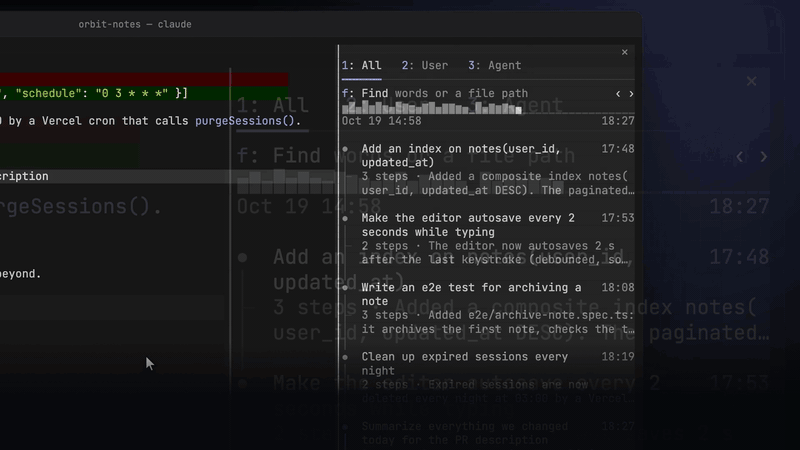

# chat-toc



In Claude Code's fullscreen terminal, chat-toc docks the current session's contents to the right of the transcript: one entry per turn of the conversation, and a click jumps back to that turn.

## Requirements

- Claude Code `>= 2.1.287` (see `claude --version`)
- An interactive terminal. In Claude Code Desktop (and VS Code and mobile) the contents show, but a click cannot jump: the Claude app does not let plugins scroll the conversation yet (see [Known limits](#known-limits)). JetBrains is not supported
- The fullscreen layout: run `/tui fullscreen` to switch
- A wide enough terminal: whether the pane can dock is Claude Code's call. Measured on 2.1.287 and 2.1.295: it docks by itself from 144 columns, and when opened with `/chat-toc` from 110 columns
- `CLAUDE_CODE_ENABLE_FUNCTION_HOOKS` is **not** needed
- Any operating system, but tested on macOS only (see [Known limits](#known-limits))

While the contents are not on screen, a line above the prompt stands in for them and opens them (see [Getting started](#getting-started)).

## Install

### Marketplace

Register the marketplace once, then install the plugin.

```sh
claude plugin marketplace add lkangd/cc-mods
claude plugin install chat-toc@cc-mods
claude plugin list
```

Check that `chat-toc@cc-mods` is enabled, then start a new Claude Code session.

### Local development

From the root of a local clone, run the plugin directly in a session where the marketplace copy is disabled.

```sh
claude --plugin-dir ./mods/chat-toc
```

## Getting started

1. Start Claude Code in the fullscreen layout. The contents dock on the right by themselves, titled "ChatTOC" (2.1.287 draws no title row).
2. If the contents do not show, the terminal is narrower than Claude Code docks them by itself, and a line above the prompt stands in for them: `ChatTOC  ‹ ›  │  12 user turns · 80 agent steps   Open contents ❯  ✕`. Where the line is too narrow for all of it, the counts shorten from the end, then the name goes; Claude Code Desktop draws no `‹ ›`. Widen the terminal and they dock by themselves, and the line goes; or click `Open contents ❯` (or run `/chat-toc`): Claude Code then docks them in a narrower terminal too, and below that places them above the prompt. Outside the fullscreen layout they open above the prompt by themselves; run `/tui fullscreen` to dock them on the right.

3. Click any entry to jump back to that turn in the conversation. After closing the pane with ✕, `/chat-toc` opens it again at any time, with the focus in it.

## Usage

### Controls

| Control | What it does |
| --- | --- |
| Click your input in an entry (from the `●` line) | Jumps to that input, at the top of the screen, and selects the entry; it opens no preview. A slash command or `!` command jumps to the row right after it and keeps the input row in sight |
| Click the Agent's reply in an entry (from the `├╴` line) | Jumps to the turn's last text reply (without one, to the last thing the turn drew), and selects the entry |
| Click a block in the row of blocks under the filters | Jumps to that turn, as clicking its entry does, but selects nothing. One block per turn, as tall as the steps the Agent took; with more turns than the pane is wide, a block stands for several and jumps to the first of them that can be jumped to. The block of the turn you are on is the bright one. Hidden with fewer than two turns or in a very short pane |
| Wheel over the contents | Scrolls the contents by entries and pauses following |
| `Ctrl+X` then `Tab`; or `/chat-toc` with an empty prompt | Moves the focus into the contents |
| Any click in the contents, with an empty prompt | Also moves the focus into the contents, so the keys below work at once. Not after `r: Reuse` (the focus goes to the prompt) or `‹ ›`. With text in the prompt the focus stays there. A key that is none of the contents' keys goes back to the prompt and is typed there, but one that is (`c`, `p`, `r`, `f`, …) acts on the contents |
| `↑` `↓` (focus in the contents) | Moves the selection one at a time (your input and the Agent's reply count one each); the selected line is inverse. Moving it opens no preview and leaves an open one where it is. Entries that cannot be jumped to can be selected too |
| `Enter` (focus in the contents) | Same as clicking the selected side: jumps and keeps the selection |
| `p`, or click `p: Preview` on the row under the selected entry | Opens the preview on that turn. The row shows while the preview is closed: `p: Preview · r: Reuse · c: Copy`, each button only when it can act (as on the preview's lines, below); `r` reuses the turn's input, `c` copies the selected side (your input, or the Agent's last text reply). `↑` `↓` pass over the row |
| `1` `2` `3`, or click `1: All` `2: User` `3: Agent` at the top | Shows all / only your input / only the Agent's replies. A thick line in the highlight colour marks the chosen one. Remembered across sessions |
| `l`, or click the "Layout: Card" button at the footer's right end | Cycles the layout Card → Compact → Timeline; the button names the one in use. Remembered across sessions |
| `p`, or click `p: ✕` at the right end of the preview's top line | Closes the preview, from the region or expanded; the list takes its rows back, and the selected entry's row of buttons comes back. Not remembered: the contents always open with the preview closed |
| `e`, or click `e: expand` on the preview's last line | Expands the preview over the list and the row of blocks: the turn whole, scrolled with the wheel, `PgUp` `PgDn` or `↑` `↓`. `e` again, or `e: ← Back` at its top, returns to the list with the preview below it; so does `Esc`. A preview opened expanded because the contents are too short closes on `e: ← Back` |
| `r`, or click `r: Reuse` on the preview's `User` line | Puts the input the preview shows back into the prompt as a draft, as you typed it: into an empty prompt, or after a blank line below what you are typing, which is never lost. Never sent: edit it or press `Enter` yourself. Works while the Agent is working too (`Enter` then queues it, as usual). The focus moves to the prompt. A `!` command has no `r: Reuse` (filled in, it would be sent to the model, not run) |
| `c`, or click `c: Copy` on the preview's `User` line | Copies that input, whole, as you typed it (a `!` command as `!command`); the button reads `Copied` for about 2 seconds. The focus stays in the contents |
| `a`, or click `a: Copy` on the preview's `Agent` line | Copies the Agent's last text reply, whole, as Markdown; the button reads `Copied` for about 2 seconds. Not offered while the turn is running |
| Click the search field under the filters, or `f` (`f: Find`) | Moves the focus into the field. Type words or part of a file path: the list narrows to the turns holding every word |
| `Enter` in the search field | Jumps to the matching turn nearest the one you are viewing and ends the search (the list is whole again, the turn jumped to highlighted). With no match it only clears the field |
| `↓` or `Tab` from the search field | Moves the selection on to the matching entries; `Enter` on one jumps there, selects it and keeps the search |
| `Esc` in the search field | Moves the focus back to the prompt and keeps the search |
| `Ctrl+U` or `Backspace` in the search field, or click the `✕` at its right end | Clears the search |
| Click `‹` or `›` at the search row's right end, or on the line above the prompt while the contents are not on screen; or a key you bind to them (see [Keys for the previous and next turn](#keys-for-the-previous-and-next-turn)) | Jumps the transcript to the turn before or after the one you are viewing (the highlighted one, not the `↑` `↓` selection), among the turns the list shows: the view choice applies, and while searching only the matches, without ending the search. It jumps to the side the view shows (your input under All and User, the reply under Agent) and the highlight stays on the turn jumped to, so each press goes one turn further. At either end nothing happens. Turns that cannot be jumped to are passed over; when no turn that way can be, the note "This entry is not in the conversation view now; cannot jump to it" shows under the list, or at the top right of the screen while the contents are not on screen |
| `Esc` (focus in the contents) | Moves the focus back to the prompt; the contents stay open |
| `Ctrl+X` then `←` / `→` | Widens / narrows the contents (a Claude Code feature). A width you set wins |
| Click ✕ | Closes the contents; they do not open by themselves again this session. A new session (including after `/clear` or `/resume`) opens them again |
| Click `ChatTOC` on the line above the prompt | Opens the contents, as `Open contents ❯` does. Claude Code Desktop, and the terminal before Claude Code 2.1.303, draw it in the plain text colour |
| Click `✕` at the right end of the line above the prompt (right after `Open contents ❯` before Claude Code 2.1.295) | Hides that line, in this session and every later one, and says how to bring it back. `/chat-toc` still opens the contents |
| `/chat-toc-band` | Shows the line above the prompt again |
| `/chat-toc` | Opens the contents when closed, brings them to the front when open (also when another pane pushed them back); either way moves the focus into them (with an empty prompt). It never closes them |
| Claude Code Desktop: click an entry | Opens the preview right under that turn's entries, in a box with a rounded border; clicking another entry moves it there. Opening it does not scroll the contents: when it falls below the edge, scroll to it. The click also asks to jump, which the Claude app refuses without a word (see [Known limits](#known-limits)) |
| Claude Code Desktop: type in the search field under the view choices | Narrows the list as on the terminal, at each change; the row of bars draws the matching turns in the accent colour and the rest dim. There is no `f: Find`: click the field |
| Claude Code Desktop: `Enter` in the search field, or its `show` button | Keeps the search and opens the preview on the newest match (the app cannot jump, nor say which turn you are viewing) |
| Claude Code Desktop: click `✕` on the preview's top line, `↓ 12 more lines · expand` on its last line, `← Back` | As `p`, `e` and `e: ← Back` on the terminal. Desktop has no hotkeys, so none of the buttons names a key |
| Claude Code Desktop: scroll the contents; click `↑ 12 earlier turns` at the list's top, `↓ 12 later turns` at its bottom, `↑ Back to top` after the last entry | The app scrolls the whole contents, the view choices and the search field with them. A long conversation lists its newest turns (as many as fit in what the app takes in one drawing, about 45 in the Card layout); `↑` lists the turns before them and `↓` goes back toward the newest, and either closes an open preview. A search or a view choice narrows the list first. `↑ Back to top` scrolls the contents back to the view choices |
| Claude Code Desktop: click `Copy` on the preview's `User` or `Agent` line | Copies as `c` and `a` do; a copy the app cannot take says "Too long to copy here". There is no Reuse in Desktop |

The hotkeys `1` `2` `3` `l` `p` `e` `f` `r` `c` `a` work only with the focus in the contents, and not while it is in the search field, which takes every letter typed; `p` `r` `c` only while the selected entry's row or the open preview shows their button; `e` `a` only while the preview is open, `e` only while it is cut or expanded (`a` not while a short preview cuts the `Agent` line, until `e`). `‹` `›` have no hotkey, and `↑` `↓` pass over them.

### Keys for the previous and next turn

chat-toc binds no key of its own. `‹` and `›` answer two Claude Code keybinding actions that are free in a normal session, so you can bind keys to them in `~/.claude/keybindings.json` and step through the conversation from the prompt, while Claude works too:

```json
{
  "bindings": [
    {
      "context": "Global",
      "bindings": {
        "meta+k": "app:toggleDiffNoiseFilter",
        "meta+j": "app:toggleDiffPreSession"
      }
    }
  ]
}
```

- `meta+k` is the previous turn and `meta+j` the next. The action names do not match because a plugin cannot add an action: chat-toc borrows two that Claude Code names for its diff view and does not use in a normal session.
- On macOS the terminal must send Option as Meta (iTerm2: Profiles → Keys → Left Option key: Esc+; Terminal: Settings → Profiles → Keyboard → Use Option as Meta key).
- Use a modified key such as `meta+k`, not a chord such as `ctrl+x p`, and not a bare key: when nothing answers a chord (the contents and the line above the prompt both away), its second key is typed into the prompt; a bare key never reaches the buttons.
- The keys press the `‹` `›` the contents draw, or, while the contents are not on screen (closed, waiting to dock, or a tab behind another pane), the ones on the line above the prompt. See [Known limits](#known-limits) for when nothing answers.

### What it shows

- **Entries**: each entry is one turn of the conversation: one input of yours, plus what the Agent did from that input to your next one. In conversation order. A slash command and a `!` command are each an entry of their own; the same prompt submitted several times is several entries; a prompt queued while the Agent worked is an entry of its own too. Background task notifications and work started by `/loop` join the entry before them. Nothing from inside a subagent shows.
- **Time rail**: entries hang on a vertical line on the left. Your input starts at a node `●`, the Agent's reply at a branch `├╴`; the lines after them and the gaps between groups on the same day sit against the line `│`.
- **Your input**: its first 2 lines, with `…` at the end when it does not fit. A slash command shows as `/command args`, a `!` command as `!command`; code blocks, Markdown marks and paste markers are left out, and an input of only images shows "(image only)". When a line folds, commas and full stops never start a line, and English words and file paths up to 14 characters move down whole.
- **The Agent's reply**: dim text, first the state and the steps, then the last text reply, at most 2 lines:
  - `N steps · reply…`: the steps are how many tools the main Agent called this turn; parallel calls count one each, a subagent counts 1, thinking and text in between do not count. With 0 steps there is no count, only the reply.
  - `N steps · No text reply`: the turn ended without a text reply.
  - `Interrupted · N steps`: you interrupted the turn.
  - `Error · N steps · error message`: the turn ended in an API error. A single failed tool call is not an error.
  - `Running · N steps`: the Agent is still working on the last turn; an orange `◐` sits by the branch and the steps count up live.
  - A local slash command, or a `!` command that set no Agent work going, has only your input. Under "Agent" those entries are hidden.
- **Time and day**: times come from the transcript, in this machine's time zone. The card layout writes the time at the right end of your input's first line (`HH:MM`); Compact and Timeline write it in a column left of the line, on each turn's first row. Where the day changes (including at the top of the list) there is a line `─ Oct 9 ───`; today reads `Today · Oct 13`, and another year's day carries the year. A turn whose time cannot be read gets no time and no day line; nothing is guessed.
- **Compactions**: where the conversation was compacted, a dashed line crosses the list, `╌ Compacted 14:32 ╌╌╌` for `/compact` and `╌ Auto-compacted 14:32 ╌╌╌` for an automatic compaction, with the time it happened (no token figures). It never cuts a turn: after `/compact` it goes below the `/compact` entry; an automatic compaction goes before the turn it happened at the submit of, and after the turn it happened in the middle of (below a running turn, at the end of the list, until the next turn comes) or between two turns. It breaks the time rail as the day line does, in every layout, and shows under every view choice, between the turns shown; several between two turns shown fold into one line with a count and the last one's time, `╌ Compacted ×3 · 14:32 ╌`. Where a day line meets it, the day line comes first. Entries above it are not dimmed.
- **Earlier turns elsewhere**: when this session's file starts at a compaction whose earlier turns it does not hold (a session forked with `--fork-session`, or a resumed file compacted before any turn of its own), a dim line at the top of the list says "Earlier turns are not in this session's file". The earlier turns are not read from anywhere else.
- **Three layouts**: Card (the default) draws up to 2 lines a side, the time at the right end; Compact draws one line a side, the time in the left column; Timeline draws up to 2 lines a side, the time in the left column. The layout changes only how entries are drawn, not which show. On a switch, the selected entry (or, with no selection, the turn being viewed) stays in view.
- **Highlight**: marks the turn you are viewing in the transcript (the turn holding the top line of the screen; the last turn when the conversation's end shows whole): the node becomes `◉`, the branch `┣╸`, the turn's line thickens to `┃`, all in the highlight colour along with the time. The highlight and the dim text follow Claude Code's theme (`/theme`); the highlight is the colour of a selected item in Claude Code's menus, and the contents follow a theme change at once. After a click jump, the highlight stays on the turn jumped to until you scroll the transcript again. A `!` command's turn (and, in a session opened with `--resume`, a local slash command's turn) has no row in the transcript to locate: when only such a row shows at the top of the screen, the highlight falls on the next turn. The highlight and the `↑` `↓` selection (inverse) are independent and can sit on different entries. With the pointer over an entry, that side's text turns the highlight colour and the line right under the pointer is inverse.
- **Search**: the row under the view choices holds `f: Find` and the field (`words or a file path` while empty). A search narrows the list to the turns that hold every word typed (words split on spaces), in any of: your input as you typed it (code blocks and pasted text included), the Agent's last text reply in full, and the full paths of the files the turn changed or read. Case does not matter, full-width and half-width letters match alike, and Chinese and other text match as plain substrings; no regular expressions, fuzzy matches or quoted phrases. It follows the view choice: All searches every field, User only your input, Agent only the reply and the paths. The row's right end says how many turns match of all (`4 of 38`) and holds `✕`, then `‹ ›` (always there, see Controls); with no match the list says "No turns match". A new turn that matches joins the list, and a running turn is matched as it writes. While searching, the list keeps the match nearest the turn you are viewing in sight (the nearest at or before it, else the first after it), the highlight shows only when that turn itself matches, the compaction lines stay between the turns shown, and the row of blocks lights the blocks holding a match instead of the one you are on (all dim with no match). The search stays through a view or layout switch, new turns, another pane in front and closing and reopening the contents, until Claude Code quits; it is never stored.
- **Top and footer**: the top holds the three view choices, a line under them marking the chosen one, the search row, then the row of blocks and the list. The footer sits at the bottom of the contents, under the preview when it is open: a thin line, under it on the left the number of turns ("12 turns", the same under every view choice) and on the right the layout button.
- **Context use**: how full the context window was at the last response, as Claude Code reports it, follows the turn count in the footer: "38 turns · context 62% used"; when the contents are narrow it shortens to "38 turns · 62% used" and then leaves it out. The line above the prompt that stands in for contents not on screen adds "· context 62% used" after its counts. It is read when the session starts and after every response, always dim, never coloured, with nothing said near the limit (Claude Code warns before compacting by itself). Until the first response, and from a compaction until the next response, Claude Code has no figure, so none shows.
- **Preview**: a region at the bottom, above the footer, shows one turn whole. It is closed until you ask for it: `p`, or `p: Preview` on the row under the selected entry, opens it on that turn, and it stays on it while you scroll the transcript, move the selection with `↑` `↓`, switch the view or layout, new turns arrive or a search leaves that turn out of the list. Opening it from another entry moves it there. A click or `Enter` on an entry, `Enter` in the search field, a block in the row of blocks, `‹ ›` and the line above the prompt open nothing. It closes with `p: ✕` at the right end of its top line, when its turn leaves the conversation (a rewind, `/clear`, another session), and whenever the contents open again; it is never stored. While searching, if the turn it shows matches, its line of figures ends with what matched, `matched: User · Agent · files`, and a matching file goes first on the files line (a matching file that was only read is named there). Its top line reads `─ Preview ─── p: ✕`; under it:
  - a dim line of what the transcript states about the turn: `Oct 16 14:32 · 12 steps · 3m 20s · 3.5k out`. The date always shows, today too; a state (`Running`, `Interrupted`, `Error`) only when the turn did not finish. The duration is how long the model worked (`45s`, `3m 20s`, `1h 5m`, `<1s`), summed over the turn's model turns, and shows only when the transcript records it; the tokens are what the main Agent wrote (`out`), each response counted once, and show only when the transcript records them. Nothing is estimated: a figure the transcript does not state is left out. When the line is too wide for the contents, its last figures are left out whole;
  - `User` with `r: Reuse · c: Copy` at the right, then your input as you typed it: code blocks and pasted text kept, a slash command as `/command args`, a `!` command as `!command`. An input of only images has neither button; an input with text and images fills or copies its text only, and a note says "Images not included";
  - `Agent` with `a: Copy` at the right, then the Agent's last text reply drawn as Markdown; a running turn shows the latest text written so far, without `a: Copy`;
  - the files the turn touched: `changed register.tsx, pane.tsx +1 · read 5`. Changed are files edited or written by the Agent and files a shell command changed as Claude Code recorded it; read are files the Agent read; a file both read and changed counts as changed. Paths are relative to the session's folder when inside it, else full with `~` for your home folder.
  The preview's height depends on the contents' height, not on the turn (about 40% of the rows below the top, 4 to 14 rows), so the list does not jump as you press another entry. What does not fit is cut, the files line first, then the Agent's reply, then your input; the last line then reads `↓ 12 more lines · e: expand`. Closed, it takes no row: the list has them. When rows run short, the row of blocks goes first, then an open preview shrinks to 4 rows; when even 4 do not fit beside the list's 8, `p` opens it expanded instead, and `e: ← Back` closes it.
  Expanded (`e`), the preview takes the place of the list and the row of blocks, under the view choices and above the footer, and draws the turn uncut: the files one per line under `Changed` and `Read`. It keeps that turn while you scroll the transcript or new turns arrive, and a running turn still grows in it. A very long input or reply is cut there, about 60,000 characters for the two together, with a line after the cut part: `… 12,345 more characters not shown · c: Copy` (`a: Copy` after the reply).
- **Reuse and copy**: the buttons act on the turn the preview shows, or the selected entry's turn on the row under it, reading the transcript at the press; nothing is kept. A filled prompt says nothing more. A fill that does not go through says why in a note: "Couldn't fill the prompt: a dialog is open" (the text is dropped, not kept for later) or "Couldn't fill the prompt: another plugin refused". A copy that Claude Code reports as failed says why, such as "Too long to copy here".
- **Following and pausing**: the contents scroll to the highlighted turn by themselves; with the transcript at its end, they stay on the newest entry. Scrolling the contents by hand, or the focus being in them, pauses following; following resumes the next time the highlight moves to another turn (you scroll the transcript to another turn, or click to jump). If the highlight changed while another pane pushed the contents back, they catch up as soon as they are in front again.
- **Entries that cannot be jumped to**: in a session opened with `--resume` (or `/resume` in a session), the turns compacted away before the resume hang on hollow marks from the start (your input on `○` with dim text, the Agent's reply on `├┄`). They can still be selected and clicked; when a jump cannot go through, a yellow line (the theme's warning colour) starting with ⚠ shows under the list, flashing inverse 3 times first: for a compacted turn "This entry was compacted before the session resumed; cannot jump to it", otherwise "This entry is not in the conversation view now; cannot jump to it". The line goes at the next jump, a move of the selection or after about 5 seconds; the side that could not be jumped to then hangs on a hollow mark until Claude Code shows that row again.
- **Notes under the list**:
  - "N lines not recognized; the contents may be incomplete": N lines of the transcript could not be read (for instance Claude Code changed its format); the rest of the contents still show.
  - "No permission to read this session's transcript; nothing to show" or "Cannot read this session's transcript; nothing to show": the contents then show no entries at all rather than a patchy list.
- **Empty contents**: a new session shows "No conversation in this session yet" before the first message; a session opened with `--fork-session` or `--resume` whose file is not written yet shows "This session has no transcript file yet; the contents appear after the first message".
- **When the session changes**:
  - `/clear`: the contents empty and rebuild with the new session (its first entry is the `/clear` itself), with no dividing line.
  - Compaction: earlier entries still show, with a compaction line where it happened; the context use leaves the footer until the next response.
  - Rewind (including Esc Esc): once the conversation is restored, the part thrown away (including the entry rewound to, whose text went back to the prompt) leaves the contents at once, without waiting for the next submit. Quit without submitting after a rewind and resume, and that part comes back with the conversation.
  - `--resume`, `--continue`, `/resume` in a session, `--fork-session`: the contents rebuild from that session and can jump to turns long ago that never showed.
  - Several terminals each show only their own session.
  - Enabling chat-toc in a running session (enable it in `/plugin`, or `claude plugin enable` then `/reload-plugins`): no restart needed; the contents list the conversation so far at once. If this session's transcript cannot be found, they show "The contents appear after the next message".
- **With other docked panes** (such as `/diff`): they share the dock by Claude Code's tab rules. A newly opened pane always comes to the front; when chat-toc is pushed back it takes no focus, and the line above the prompt shows (`ChatTOC  ‹ ›  │  …   Open contents ❯  ✕`) as it does while the contents are closed; brought to the front, the contents draw again and the line goes.
- **A narrowing terminal**: when the terminal gets so narrow that Claude Code moves the docked contents above the prompt, they stay there and still list the entries; widen it and they dock again.
- **Language**: the words follow the system language: Chinese when the first set of `LC_ALL`, `LC_MESSAGES` and `LANG` starts with `zh`, English otherwise. This README quotes the English words.

## Data and privacy

- Reads only the current session's transcript file (the one Claude Code writes itself), taking the rows along the current branch. Past 4 MiB it runs a read-only local `sh` (`dd` with `head`; Windows PowerShell on Windows) to read it in chunks by offset.
- Writes no files, keeps no archive, never goes online, and has no consent flow.
- The plugin's store keeps three preferences only: the view (all / User / Agent), the layout, and whether the band above the prompt is hidden. Whether the preview is open, and on which turn, is held in memory only (a value an earlier 0.2 build stored for the preview is ignored). Prompt text, the search you type, file paths, durations and token counts are held in memory only and appear only in what the contents draw, never in the store, logs or error messages. Text goes to the prompt or the clipboard only when you press `r`, `c` or `a`.

## Known limits

- Below Claude Code `2.1.287` the plugin neither checks nor says anything.
- In Claude Code Desktop the contents can be read but not jumped from: the Claude app answers every scroll from a plugin with `transcript not scrollable here` and does not tell plugins where the conversation is scrolled, so the current position is not highlighted; a click on an entry tries to jump, says nothing when the app refuses, and stops trying for the session. Followed up in [anthropics/claude-code#100610](https://github.com/anthropics/claude-code/issues/100610). How Desktop looks was checked by eye in the Claude app; VS Code and mobile are covered by element-tree tests only; JetBrains is not supported.
- On the terminal a copy cannot be confirmed: Claude Code reports success whatever the clipboard got (with no clipboard tool on the machine, or a terminal that drops the escape sequence, nothing arrives and `Copied` still shows).
- Images in a prompt are not reused or copied, only its text.
- Accepted for real on macOS only. On Linux and Windows only the commands generated for reading large files were checked, not run on real machines; Windows uses only the built-in Windows PowerShell 5.1.
- The transcript file format is not public. If Claude Code changes it, the contents may show only in part, and the bottom says how many lines could not be read.
- When enabled mid-session, the transcript's location is worked out from Claude Code's unpublished folder naming rule; if the rule changes, the contents wait for your next submit.
- Jumping to rows compacted away before a `--resume` is not guaranteed (with `--resume` they hang on hollow marks from the start); when a jump cannot go through, a note under the list says so and that side hangs on a hollow mark.
- The preview shows no duration in Claude Code Desktop, nor for most interrupted turns: the transcript does not record it there.
- The preview's tokens are the main Agent's output only; what subagents wrote is not counted.
- A very long prompt or reply is cut in the expanded preview (copying takes the whole text).
- A forked session does not show the parent session's turns: a line at the top of the list says earlier turns are not in this session's file.
- Context use in Claude Code Desktop is not promised: it was not measured there, and shows only when the Claude app gives a figure, after the turn count under the row of bars.
- No Reuse in Claude Code Desktop, only copy: the Claude app reports a fill as done while its prompt box sometimes does not show the text. Reuse comes back there when a version of the app shows fills reliably.
- How the three layouts look, and whether the highlight and the inverse selection tell apart, is checked by a person and does not block a release.
- No fixed speed is promised on every machine; the release's performance numbers come from one reference machine (an Apple M1 Pro Mac: on a 20 MB-class long session, the contents show within about 0.7 s after Claude Code shows the last turn, and scrolling and jumping do not stutter).
- Contents sitting above the prompt (outside the fullscreen layout, or where they cannot dock): their layouts, following and highlight are not accepted.
- The PTY acceptance runs check the Chinese words; the English words are covered by unit tests only.
- The keys for the previous and next turn rest on two borrowed action names that a later Claude Code may take for itself; the keys then stop stepping without a word. Nothing answers them while the line above the prompt is collapsed (`Ctrl+X` `Ctrl+A`), under a tool permission prompt, or in Claude Code Desktop, which draws no `‹ ›` (it cannot jump at all). Claude Code does not redraw the line above the prompt when only the tabs switch (a click on a tab, `pane:next`), so right after chat-toc goes behind another pane that way the keys may not answer until something else redraws it (a new message, a response, a pane opened or closed); opening another pane, such as `/diff`, redraws it.

## Uninstall

```sh
claude plugin uninstall chat-toc@cc-mods
```

For a local load, start Claude Code without `--plugin-dir ./mods/chat-toc`.

After uninstalling, the preferences may remain in `~/.claude/plugins/store/chat-toc_*.json` (a marketplace install is `chat-toc_cc-mods-*.json`, a local load `chat-toc_chat-toc-local-*.json`; older builds wrote `chat-toc_inline-*.json`; with `CLAUDE_CONFIG_DIR` set, under its `plugins/store/`). Delete them by hand if you like; they hold no prompt text either way.

## Development

- Domain terms (Transcript, Turn group, User input, Agent reply, View filter, Layout, Current position, Jump target) are in [`CONTEXT.md`](CONTEXT.md). The code and this file use these terms; text for users always uses the words on screen.
- Spec and tickets: the MVP (0.1) in `.scratch/chat-toc/spec.md` and `.scratch/chat-toc/issues/`, 0.2 in `.scratch/chat-toc-0.2/spec.md` and `.scratch/chat-toc-0.2/issues/`. Comments cite them as "MVP spec §N" and "0.2 spec §N".

### Layout of the folder

```text
mods/chat-toc/
├── .claude-plugin/plugin.json   name chat-toc, version, "types": "./types/index.d.ts"
├── .claude/types/claude-code.d.ts   2.1.287's host type declarations (tsc checks the minimum version with them)
├── types/index.d.ts             the $.state contract (members written inline in PluginState['chat-toc'])
├── hooks/
│   ├── hooks.json               loads ./register.tsx only
│   ├── register.tsx             every line that touches $, and every hook; the other files are pure functions
│   ├── text.ts                  every word drawn or said, English and Chinese, picked by the locale
│   ├── transcript.ts            parses JSONL rows
│   ├── chain.ts                 the current branch's conversation chain (parentUuid; across a compaction boundary, logicalParentUuid)
│   ├── groups.ts                when a group opens, the User input text, steps, last text, ending
│   ├── facts.ts                 each group's facts for the preview, search and reuse: the input as typed, files changed/read, duration, output tokens, the last text as Markdown
│   ├── regroup.ts               incremental regrouping (only from the last group's opening row)
│   ├── compactions.ts           compaction boundaries placed between groups, their rules among the groups shown (×N fold), the fork line's condition
│   ├── model.ts                 whole regrouping; a test oracle only, register does not use it
│   ├── source.ts                whole read up to 4 MiB, 4,000,000 B chunks past it (sh dd+head / Windows PowerShell 5.1)
│   ├── reader.ts                the gate: 300 ms trailing, reads merged while one runs
│   ├── entries.ts               entries for the three Layouts and the View filter, day rules, time format, the Agent side's state words
│   ├── table.ts                 the entry table: entries cached per group, rebuilt only when the data, width, filter or Layout change; group-to-entry lookup; the table narrowed to a query's matches
│   ├── cells.ts                 terminal cell widths and folding (no closing punctuation at a line's start, English words kept whole)
│   ├── window.ts                the Pane's own visible window
│   ├── bars.ts                  the terminal Minimap: a one-cell Button per Turn group, blocks by steps, buckets past the width, the press target, the hide rule
│   ├── ring.ts                  the host's focus ring on an entry's first line, scrolling at the window's ends, stepping over ‹ › and the Minimap
│   ├── view.ts                  the View filter / Layout $.store keys, the default for a value not known
│   ├── sites.ts                 transcript site records and the four-step requestId → row match
│   ├── jump.ts                  each side's jump candidates, refusal notes and dimming
│   ├── memo.ts                  the one-entry memo a drawing keeps its work in (the matches, the narrowed and ruled list, the preview)
│   ├── position.ts              Current position: on-screen row runs, binary search, the jump lock
│   ├── perf.ts                  timing samples under CHAT_TOC_PERF (numbers only), written to the host's debug log
│   ├── lifecycle.ts             the close mark, when to reopen, placement outcomes
│   ├── locate.ts                works out the transcript path when enabled mid-session (the host's project folder naming)
│   ├── rewind.ts                after a rewind, lines the host's messages up with the file to find the groups no longer held
│   ├── preview.ts               the preview's words (meta line, files line), its size against the rows (and what gives way first), what of a group fits
│   ├── reuse.ts                 Reuse and copy: which label-row Buttons a group gets, the text each takes, how a fill keeps the draft
│   ├── search.ts                search: each group's NFKC lower-cased fields indexed at regroup, the matcher (words AND, the View filter's fields), the match nearest a position
│   ├── walk.ts                  ‹ ›: the borrowed actions, the groups the list shows, the walk from the Current position to the previous or next one with a Jump target
│   ├── pane.tsx                 the terminal Pane (filter row and tab rule, the search row, entries on the time rail, the preview region, footer)
│   ├── desktop.tsx              the Pane on Desktop / VS Code / mobile (another tree, split on e.surface); what an entry costs serialized
│   ├── span.ts                  the part of the list Desktop draws: the newest Turn groups within a character budget, moved by ↑ and ↓
│   └── minimap.ts               the SVG strip of steps per turn over the desktop list
└── tests/
    ├── *.test.ts                the claude plugin test suite
    ├── fixture.ts, host.ts      the synthetic transcript builder; the host stand-in over the test kit
    ├── acceptance/              the independent verifier, fixture generator, PTY driver and scenario scripts
    └── evidence/<version>/      release evidence (added by the release commit)
```

The host has a static check at load: `$` may only be passed to functions declared at the top of `register.tsx`, spelled `$.noun.method(...)`. Passing it to an imported function or a closure makes the module fail to load, so new code that touches `$` always goes in `register.tsx`.

### Language

The words follow the system's language (`hooks/text.ts`): Chinese when the first set of `LC_ALL`, `LC_MESSAGES` and `LANG` starts with `zh`, English otherwise. The host has no locale API, so `register.tsx` reads those variables once a load, at the first start event. A new word goes into both tables in `text.ts`; tests for the English words are in `tests/language.test.ts`. The older suites check the Chinese words: `tests/host.ts` starts its worlds with `LANG=zh_CN.UTF-8`, the pure tests call `setLanguage('zh')`, and the PTY worlds set `LC_MESSAGES=zh_CN.UTF-8`.

### Local development notes

- `CLAUDE_CODE_ENABLE_FUNCTION_HOOKS` is not needed. Turn on the fullscreen layout with `/tui fullscreen` (or `"tui": "fullscreen"` in settings).
- Hot reload: change (or touch) `hooks/register.tsx` under `--plugin-dir`. `/reload-plugins` does not reload an unchanged hooks module (debug log `hooks modules unchanged, kept as loaded`).
- To see what the plugin did, start with `--debug-file <path>`: the log has lines like `hooks module chat-toc@inline reloaded`, `ui.open chat-toc chat-toc (unasked|asked, N columns): …`, `ui.close …`.
- To time it, also set `CHAT_TOC_PERF=1`: the plugin writes the time spent reading, regrouping, redrawing the Pane and computing the Current position as `chat-toc-perf {...}` lines in the debug log, at most one batch a second. Numbers only (milliseconds and counts), no prompts, uuids or paths; without the variable nothing is timed or written.

Do not install the minimum host, 2.1.287, globally; either:

```sh
npm install --prefix <temp dir>/cc287 @anthropic-ai/claude-code@2.1.287   # the binary is node_modules/.bin/claude
npx -y -p @anthropic-ai/claude-code@2.1.287 claude ...                     # what the PTY driver's Host("2.1.287") does
```

### Automated tests

The fast gate `mods/chat-toc/scripts/verify-startup.sh` (about 20 seconds) runs the checks below and the acceptance tools' unit tests, both versions through `npx`, with nothing installed globally. The repository's pre-commit hook (`.githooks/pre-commit`; enable it once per clone with `git config core.hooksPath .githooks`) runs a mod's gate when a commit touches that mod's non-Markdown files.

To run one of them, from the repository root:

```sh
claude plugin test mods/chat-toc                 # only the current version must pass
claude plugin validate mods/chat-toc             # current version
<cc287>/node_modules/.bin/claude plugin validate mods/chat-toc   # 2.1.287
(cd mods/chat-toc && npx -y -p typescript@5.6.3 tsc -p tsconfig.json)   # against 2.1.287's type declarations
```

- 2.1.287's test kit has no bottom for `session.append`, so the tests that rely on it run on the current version only.
- The test kit hands neither the plugin's `$.ui.scroll` of the transcript nor its own `$.ui.focus` to the test's hooks (it says no implementation), and cannot press the person's ✕. Jumps, where the focus lands and the person's close are tested on pure functions; their real effect is checked in PTY acceptance.
- To type-check against 2.1.295 or another newer version, write a tsconfig outside the plugin that includes the `types/claude-code.d.ts` the `plugin-authoring` skill writes and `mods/chat-toc/{types,hooks,tests}`.

The acceptance tools' own unit tests (verifier, fixture generator, driver) use the standard library only:

```sh
cd mods/chat-toc/tests/acceptance && python3 -m unittest test_toc_verifier test_transcript_fixture test_pty_harness
```

### PTY acceptance

The second layer runs in the real host, judged by `tests/acceptance/toc_verifier.py`: it works out the expected entries on its own along the transcript file's conversation chain and compares them one by one with the entries read off the Pane, sharing no code with the plugin.

**Setup**. Driving the terminal needs pyte, at the version in `tests/acceptance/requirements.txt`:

```sh
python3 -m venv <venv> && <venv>/bin/pip install --require-hashes -r mods/chat-toc/tests/acceptance/requirements.txt
PY=<venv>/bin/python
```

Every start is in a temporary HOME and `CLAUDE_CONFIG_DIR`: onboarding done, the project trusted, fullscreen, no plugin but the one given with `--plugin-dir`, not logged in. Your own `~/.claude` is never touched. Logged out, you can `--resume` a synthetic transcript, click, scroll and run local slash commands, and a submitted prompt is still written to the transcript (the host answers with its own line `Not logged in · Please run /login`), all without calling a model. When a real turn is needed, set `CHAT_TOC_PTY_TOKEN` (a token from `claude setup-token`): the driver passes it as `CLAUDE_CODE_OAUTH_TOKEN` and adds `--model haiku`. Synthetic prompts only; no real conversation content.

**Scenario scripts** (run from the repository root; `--host` takes `2.1.287` or `current`, the latter the `claude` on PATH):

| Scenario | Command |
| --- | --- |
| Smoke: the whole list matches the verifier, a click jumps | `$PY mods/chat-toc/tests/acceptance/pty_harness.py smoke --host 2.1.287 --plugin mods/chat-toc [--fixture forms] [--terminal cmux]` |
| CT-COMPAT-003 | `$PY mods/chat-toc/tests/acceptance/ct_compat.py --host 2.1.287 --host current [--scenario waiting\|narrowed\|asked\|main\|reload]` |
| CT-LIFE-001, 002, 005 (fork) | `$PY mods/chat-toc/tests/acceptance/ct_life.py --host 2.1.287 --host current [--scenario 001\|002\|fork]` |
| CT-LIFE-007 | `$PY mods/chat-toc/tests/acceptance/ct_mid_session.py --host 2.1.287 --host current [--scenario cli\|ui]` (installs from a folder marketplace set up in the run folder, disabled first, then enabled mid-session from the CLI and from the `/plugin` screen) |
| CT-LIFE-003, 004, 005, 008, CT-DATA-006 | `$PY mods/chat-toc/tests/acceptance/chain_scenarios.py --host 2.1.287 [--only life-003,...]` |
| CT-PREV-001 (the preview region, opened by `p` on an entry selected), CT-PREV-002 (expanded) | `$PY mods/chat-toc/tests/acceptance/ct_preview.py --host 2.1.287 [--host current] [--only press,close,facts,cut,short,widths,expand,cap,running]` (`expand`, `cap` and `running` record CT-PREV-002; `running` runs against `fake_api.py`, no model call) |
| CT-REUSE-001 (Reuse and copy) | `$PY mods/chat-toc/tests/acceptance/ct_reuse.py --host 2.1.287 [--host current] [--only fill,copy,rules,closed,dialog,running,widths]` (writes the system clipboard and puts the person's back at the end; `running` runs against `fake_api.py`; `widths` also runs in English) |
| CT-FIND-001, CT-FIND-002 (search) | `$PY mods/chat-toc/tests/acceptance/ct_search.py --host 2.1.287 [--host current] [--only narrow,filter,live,widths,keys,entry,keep,minimap]` (`widths` also runs in English; `keep` makes a temporary project a repository with a change, so `/diff` opens) |
| CT-STEP-001 (‹ ›, the keys bound) | `$PY mods/chat-toc/tests/acceptance/ct_walk.py --host 2.1.287 [--host current] [--only pane,keys]` (`keys` writes the world's `keybindings.json` binding `meta+k`/`meta+j`, runs one turn against `fake_api.py` on 127.0.0.1, and makes the project a repository with a change, so `/diff` opens) |
| CT-CMPCT-001 (a query's part too), CT-CTX-001, CT-LIFE-003 (live `/compact`) | `$PY mods/chat-toc/tests/acceptance/ct_compaction.py --host 2.1.287 [--only fixture,fork,live]` (`live` runs against `fake_api.py` on 127.0.0.1 stating chosen `usage` figures; no model call) |
| CT-JUMP-001–003, 005, CT-UI-005 | `$PY mods/chat-toc/tests/acceptance/jump_scenarios.py 2.1.287 [001 002 002b 003 005]` (005 also records CT-UI-005: the notice line's inverse and foreground read about every 30 ms) |
| CT-POS-001–003, CT-COEX-001, CT-LIFE-006, CT-MAP-001 | `$PY mods/chat-toc/tests/acceptance/position_scenarios.py 2.1.287 [pos1 pos2 pos3 coex life6 map1]` (coex runs `git init` on a repository with changes in a temporary project, so `/diff` opens) |
| CT-PERF-001, CT-PERF-002 (20 MiB many/heavy, 3 runs each; the preview opened by a click, queries typed into the search field) | `$PY mods/chat-toc/tests/acceptance/perf_scenarios.py run 2.1.287 many --runs 3` (then `heavy`, `current`); the release report's tables: `$PY mods/chat-toc/tests/acceptance/perf_scenarios.py table <run folder>...`. The Current position and the entry table under 3000 stale on-screen records, and the search index and a keystroke's matching on 4432 turns, are measured in `tests/long_session.test.ts` (`claude plugin test` prints `CT-PERF` lines) |
| CT-COMPAT-001, CT-DATA-001–005, CT-TURN-001–005, CT-UI-001–003, CT-SEC-001 | `$PY mods/chat-toc/tests/acceptance/gate_scenarios.py --host 2.1.287 [--only compat-001,data-002,forms,turn-004-live,ui-003,sec-001,...]` |
| CT-COMPAT-002 (marketplace smoke) | `$PY mods/chat-toc/tests/acceptance/ct_marketplace.py --host 2.1.287 --host current --source local\|github` (`local` is this repository's folder, run before a release; `github` is `lkangd/cc-mods`, the install-level check after it) |
| Screens of the three Layouts (for the visual check) | `.scratch/chat-toc/assets/25-layouts/capture.py` (with `check_screens.py`, `probe.py`, `remember.py`, `ring_check.py`) |
| The whole release gate | `$PY mods/chat-toc/tests/acceptance/release_gate.py run --host 2.1.287 --gate <folder> --screens` (the current version also takes `--types <claude-code.d.ts>`); the two versions can run in parallel. Then `release_gate.py report --gate <folder> --out mods/chat-toc/tests/evidence/<version> --commit <commit under test> --screens` writes the evidence folder |

CT-TURN-004's in-progress state (`进行中 · N 步`) needs a turn actually running: `gate_scenarios.py`'s `turn-004-live` uses `fake_api.py` (a local stand-in for the Messages API that answers from a script; `ANTHROPIC_BASE_URL` points at it) to run two Read steps and finish, with no model call. The fixture generator `transcript_fixture.py` has four kinds, with fixed seeds: `forms` (every row shape the spec names), `turns`, `many` (20 MiB, about 4500 turns), `heavy` (20 MiB, about 108 turns with large tool results).

The PTY worlds check the Chinese words (see Language). The English words are covered by `tests/language.test.ts`; in the PTY only `ct_search.py widths` and `ct_reuse.py widths` run in English.

**cmux**. The scenario scripts use pyte by default (headless, sized at will, colours readable). To watch a run in cmux, `pty_harness.py smoke --terminal cmux` opens a `--focus false` split in the current workspace and closes it at the end; it only touches the split it opened. Note:

- A cmux split's width is not under control. Below 144 columns the pane does not dock by itself, so smoke uses `/chat-toc` instead (docks from 110 columns), which adds a group to the transcript.
- The wheel and click sequences cmux sends are also taken by the host as Escape: each click may raise the rewind dialog, and wheeling the Pane during a turn interrupts it. Use pyte for whole-list comparisons.
- The host draws `dimColor` as the current theme's `inactive` foreground (not SGR 2; the acceptance worlds use the dark theme, `999999`), and a hovered entry is inverse. Move the pointer off before judging dimness in pyte.

**Run records**. Each run writes to `mods/chat-toc/build/pty-runs/<time>-<label>/` (gitignored): `run.jsonl` has one line per scenario (scenario ID, Claude Code version, plugin, fixture, expected, actual, result, evidence, OS, architecture, time); `screens/` holds the screen texts. A release copies only the chosen run folders into the evidence folder.

### Evidence folder

[Release evidence for 0.2.0](tests/evidence/0.2.0/) (plugin code under test 3ac792b; the release raised the version in 1cd431d, with only comments changed in the code between them). All 46 MUST scenarios ran under `--plugin-dir` on Claude Code 2.1.287 and 2.1.295: 188 records, with no failures, nothing missing and nothing skipped; the local folder marketplace smoke, run again at 0.2.0, passed on both versions, and the GitHub install-level check after the release is in [marketplace.md](tests/evidence/0.2.0/marketplace.md).

- `tests/evidence/<plugin version>/`, one folder per version, committed. A new version reruns the full MUST gate in a new folder; old folders are not changed. There is no CHANGELOG.
- The folder holds three files:
  - `report.md`: for people; both Claude Code versions in one report, a column each, with the visual check's sign-off;
  - `report.json`: one record per scenario with the plugin version, Claude Code version, OS, architecture, fixture, scenario ID, expected, actual, result and evidence links, plus the hash of the commit under test;
  - `marketplace.md`: the local folder marketplace smoke (CT-COMPAT-002) and the GitHub install-level check after the release.
- The scenario list and MUST levels follow `.scratch/chat-toc/issues/06-grill-acceptance-contract.md` §4. Any MUST that fails, is missing, is skipped or has no traceable evidence blocks the release.
- Evidence holds synthetic prompts only. CT-SEC-001's unique marker must not appear in it.

### Release checklist

Tick in order; stop at the first step that fails:

1. [ ] `version` in `plugin.json` is the version to release; `tests/evidence/<version>/` is created.
2. [ ] On this macOS machine, run every MUST scenario once with `--plugin-dir` on 2.1.287 and on the current version of the day: no failures, nothing missing, nothing skipped; `claude plugin test`, `validate` on both versions and `tsc` on both versions are clean.
3. [ ] Run the CT-COMPAT-002 smoke from a local folder marketplace on both versions (install, the Pane opens by itself, one click on a User input side jumps), and write it into `marketplace.md`.
4. [ ] Check by eye how the three Layouts look and whether the highlight (the theme's `suggestion` colour) and the inverse selection cursor tell apart, and sign in `report.md` (does not block the release).
5. [ ] The release commit: in **one commit**, the marketplace entry (`.claude-plugin/marketplace.json`: `name`/`source`/`description`/`version`/`author`, no `category` or `tags`), the version in the root README's table and the passing results under Development in this README, and `tests/evidence/<version>/`. No git tag.
6. [ ] After pushing, first confirm `gh repo view lkangd/cc-mods --json defaultBranchRef -q .defaultBranchRef.name` prints `main` (`marketplace add lkangd/cc-mods` reads the default branch; 0.1.0's first release was withdrawn because it was not `main`), then run an install-level check from `lkangd/cc-mods`: `claude plugin marketplace add lkangd/cc-mods`, `claude plugin install chat-toc@cc-mods`, the right version and enabled in `claude plugin list`, and the Pane opening by itself as a fullscreen session starts. Add the result to `marketplace.md` (this step is not a new release). A local folder marketplace runs the source folder as is; only the GitHub marketplace copies it to the cache, so this step cannot be skipped.
7. [ ] If step 6 fails, withdraw the release commit.
